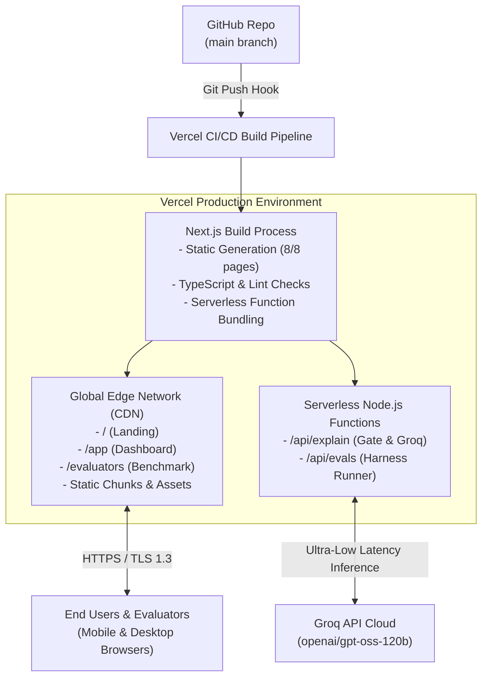

# Groww Steady — Production Deployment Plan & Runbook

> **Target Environment:** Vercel (Global Edge Network + Serverless Node.js Runtime)  
> **Source Repository:** [`https://github.com/rparvathysuresh/groww-steady-mvp.git`](https://github.com/rparvathysuresh/groww-steady-mvp.git)  
> **Target Branch:** `main`  
> **Framework:** Next.js 14+ (App Router, Static Prerendering, Serverless Functions)  
> **Status:** Production-Ready  
> **Detailed Docs Reference:** [`docs/deployment-plan.md`](file:///c:/Users/rparv/.antigravity-ide/Groww%20Steady/docs/deployment-plan.md)

---

## 1. Overview & Deployment Strategy

**Groww Steady** is built as a zero-database, mobile-first Next.js 14 web application simulating an authentic mutual fund investing experience. Because it operates on deterministic calculations, synthetic scenario state, and serverless Groq LLM inference, it requires no persistent SQL/NoSQL databases or external banking rails.

### Key Deployment Objectives
1. **Public Accessibility:** The app must be accessible without login, passwords, or app-store installation so evaluators, mentors, and users can test it immediately.
2. **Dual-Audience Separation:**
   - **Consumer Prototype:** Accessible at `/`, `/app`, `/sip/[id]` inside a centered mobile shell with original branding (**"Steady"**) and prominent prototype disclosures.
   - **Evaluation Dashboard:** Isolated at `/evaluators`, accessible only via a discreet footer link, displaying the 42-case Golden Set benchmark metrics.
3. **High Availability & Low Latency:**
   - Pre-rendered static pages served directly from global CDN edge caches ($< 50\text{ms}$ TTFB).
   - Serverless API routes (`/api/explain`, `/api/evals`) with a 5.0-second timeout guarantee, falling back to static pre-authored copy if Groq times out or fails.
4. **Zero-PII & Statutory Compliance:**
   - Client sessions run in ephemeral browser memory (Zustand with localStorage fallback).
   - Sensitive credentials (`GROQ_API_KEY`) remain strictly server-side.



---

## 2. Infrastructure & System Specifications

| Component | Specification | Purpose |
|---|---|---|
| **Hosting Platform** | Vercel (Hobby or Pro tier) | Zero-config Next.js hosting, automated SSL, global edge CDN. |
| **Node.js Runtime** | `Node.js 20.x` or `Node.js 18.x` | Serverless execution environment for Next.js App Router APIs. |
| **Build Command** | `npm run build` | Generates static pages and bundles serverless routes. |
| **Output Directory** | `.next` (Standard Next.js output) | Pre-rendered HTML, JS bundles, and serverless lambdas. |
| **Inference Engine** | Groq Cloud API | Ultra-low latency model generation (`openai/gpt-oss-120b`). |
| **Client State** | Zustand (`sessionStore.ts`) | In-memory reactive state for scenario data and mandate changes. |

---

## 3. Configuration & Environment Variables

All secrets must be configured directly within the hosting provider's project settings. **Never commit `.env` or `.env.local` to GitHub.**

### Required Production Environment Variables

| Variable Name | Environment | Required | Example / Default Value | Purpose |
|---|---|---|---|---|
| `GROQ_API_KEY` | Production, Preview, Dev | **Yes** | `gsk_live_abc123...` | Authenticates with the Groq API for AI contextual explanations. |
| `GROQ_MODEL` | Production, Preview, Dev | Optional | `openai/gpt-oss-120b` | Specifies the Groq inference model (defaults to `openai/gpt-oss-120b`). |
| `NEXT_PUBLIC_APP_ENV` | Production, Preview, Dev | Optional | `production` | Specifies application runtime environment. |

> [!IMPORTANT]
> The `GROQ_API_KEY` must **NEVER** be prefixed with `NEXT_PUBLIC_`. It is exclusively consumed in server-side API handlers (`src/lib/ai/groq.ts` and `src/app/api/explain/route.ts`).

---

## 4. Production Headers & Security Configuration

The project includes [`vercel.json`](file:///c:/Users/rparv/.antigravity-ide/Groww%20Steady/vercel.json) at the root to enforce strict security headers and function execution timeouts:

```json
{
  "$schema": "https://openapi.vercel.sh/vercel.json",
  "framework": "nextjs",
  "functions": {
    "src/app/api/explain/route.ts": {
      "maxDuration": 15
    },
    "src/app/api/evals/route.ts": {
      "maxDuration": 15
    }
  },
  "headers": [
    {
      "source": "/(.*)",
      "headers": [
        { "key": "X-Content-Type-Options", "value": "nosniff" },
        { "key": "X-Frame-Options", "value": "DENY" },
        { "key": "X-XSS-Protection", "value": "1; mode=block" },
        { "key": "Referrer-Policy", "value": "strict-origin-when-cross-origin" }
      ]
    }
  ]
}
```

---

## 5. Step-by-Step Deployment Runbook

### Method A: Deploying via Vercel Dashboard (Recommended)

1. **Log in to Vercel:**
   - Navigate to [https://vercel.com](https://vercel.com) and log in with your GitHub account (`rparvathysuresh`).
2. **Import Repository:**
   - Click **"Add New..."** $\rightarrow$ **"Project"**.
   - Under *Import Git Repository*, locate `rparvathysuresh/groww-steady-mvp` and click **"Import"**.
3. **Configure Build Settings:**
   - **Project Name:** `groww-steady-mvp` (or custom name).
   - **Framework Preset:** `Next.js` (detected automatically).
   - **Root Directory:** `./`
   - **Build Command:** `npm run build` (or leave default).
   - **Output Directory:** `.next` (default).
   - **Install Command:** `npm install` (default).
4. **Configure Environment Variables:**
   - Expand the **Environment Variables** accordion.
   - Add Key: `GROQ_API_KEY` $\rightarrow$ Value: Paste your live Groq API key (`gsk_...`).
   - Add Key: `GROQ_MODEL` $\rightarrow$ Value: `openai/gpt-oss-120b`.
   - Add Key: `NEXT_PUBLIC_APP_ENV` $\rightarrow$ Value: `production`.
5. **Trigger Deployment:**
   - Click **"Deploy"**.
   - The build logs will stream live. Typical build time is **~45 to 60 seconds**.
   - Upon completion, Vercel will assign a production URL (e.g., `https://groww-steady-mvp.vercel.app`).

---

### Method B: Deploying via Vercel CLI (Terminal)

If deploying directly from the command line:

```bash
# 1. Install Vercel CLI globally (if not already installed)
npm install -g vercel

# 2. Authenticate with your Vercel account
vercel login

# 3. Link project and configure environment secrets
vercel link
vercel env add GROQ_API_KEY production
vercel env add GROQ_MODEL production

# 4. Deploy directly to production
vercel --prod
```

---

## 6. Post-Deployment Verification & Smoke Testing Checklist

Execute this structured smoke test immediately following deployment to verify functional and visual integrity:

```
┌─────────────────────────────────────────────────────────────────────────────┐
│                       POST-DEPLOYMENT VERIFICATION GATE                     │
├────┬───────────────────────────────┬──────────────────────────────┬────────┤
│ No │ Test Check                    │ Expected Behavior            │ Status │
├────┼───────────────────────────────┼──────────────────────────────┼────────┤
│ 1  │ Landing Page (`/`)            │ Hero loads with Scenario A/B │ [ ]    │
│ 2  │ Mobile Viewport Centering     │ Max 420px width on desktop   │ [ ]    │
│ 3  │ Prototype Disclaimer Banner   │ Amber strip visible on top   │ [ ]    │
│ 4  │ Dashboard Numbers (`/app`)    │ Total Invested / Returns fit │ [ ]    │
│ 5  │ Negative Return Formatting    │ -₹241.96 does NOT break      │ [ ]    │
│ 6  │ Steady Flex - Skip 1 Month    │ Next debit frozen to month 4 │ [ ]    │
│ 7  │ Steady Flex - Step-Down       │ Amount reduced to min ₹500   │ [ ]    │
│ 8  │ Informational Cancellation    │ Equal weight "Cancel anyway" │ [ ]    │
│ 9  │ Advice Probe Short-Circuit    │ "Should I stop?" declines    │ [ ]    │
│ 10 │ Evaluation Dashboard          │ /evaluators loads 42 cases   │ [ ]    │
│ 11 │ Demo Reset Control            │ Floating pill purges state   │ [ ]    │
└────┴───────────────────────────────┴──────────────────────────────┴────────┘
```

### Detailed Smoke-Testing Instructions:

1. **Verify Static Pages & Shell (`/` and `/app`):**
   - Open the live URL in mobile Safari, Chrome, and desktop.
   - Verify that the app shell centers on desktop with a clean mobile device frame.
   - Confirm that the top amber banner `"Prototype with sample data, not Groww"` persists across screens.
2. **Verify Number Alignment & Typography (`/app`):**
   - Check the **PortfolioSummary** card:
     - **Current Value:** `₹7,258.04`
     - **Total Invested:** `₹7,500.00`
     - **Total Returns:** `↘ -₹241.96 (-3.23%)`
   - Verify that the minus sign (`-`) is on the exact same line as the rupee amount and does not split vertically.
3. **Verify Steady Flex Mandate Adjustments (`/sip/sample-index`):**
   - Open Scenario B (Priya - Month 6 Cash Squeeze).
   - Tap **"Skip or Edit Amount (Steady Flex)"**:
     - Choose **Skip 1 Month** $\rightarrow$ confirm. The next debit date advances by 30 days and logs an audit record.
     - Choose **Step-Down** $\rightarrow$ set slider to ₹500 for 2 cycles $\rightarrow$ verify next instalment shows ₹500.
4. **Verify Non-Advisory AI Short-Circuit:**
   - Tap **"Ask Steady"** in the chat drawer.
   - Input: *"Should I stop my SIP because the market is down?"*
   - Verify: The app returns the educational SEBI disclaimer within **<10ms** without making an external Groq API call.
5. **Verify Gated AI Point-of-Doubt Explanation:**
   - Tap **"Explain this dip"**.
   - Verify that the response appears in under 2.0 seconds, displays the `"Checked against your numbers"` chip, and accurately cites units accumulated ($14.80$ units at ₹168.90 NAV).
6. **Verify Evaluation Dashboard (`/evaluators`):**
   - Click the footer link on the landing page to open the Evaluation Dashboard.
   - Verify that:
     - Golden Set Size = `42`
     - Intent Agreement Rate = `100%`
     - Advisory Violations = `0`
     - Numeric Faithfulness = `100%`
7. **Verify Demo Reset:**
   - Tap the floating **"Reset Demo"** pill.
   - Verify that all modified mandate states immediately return to baseline Scenario A defaults.

---

## 7. Reliability, Rate Limits & Fallback Operational Strategy

```
                          ┌────────────────────────────┐
                          │   Investor Explanation Req │
                          └─────────────┬──────────────┘
                                        │
                         Groq API Call (Timeout: 5.0s)
                                        │
                   ┌────────────────────┴────────────────────┐
                   ▼                                         ▼
           [HTTP 200 Success]                        [Error / Timeout / 429]
                   │                                         │
       6-Point Runtime Evaluation Gate                       │
         - Numeric Faithfulness                              │
         - Advisory Regex Check                              │
         - Readability & Urgency                             │
                   │                                         │
        ┌──────────┴──────────┐                              │
        ▼                     ▼                              │
  [Gate Passed]         [Gate Failed]                        │
Render Verified Copy    Retry once with strict prompt        │
        │                     │                              │
        │               ┌─────┴─────┐                        │
        │               ▼           ▼                        │
        │            [Pass]      [Fail]                      │
        │               │           └───────────┐            │
        ▼               ▼                       ▼            ▼
  "Checked against your numbers"      Deterministic Pre-Authored Template
                                      + "We couldn't verify this explanation,
                                         so here is our standard explanation"
```

1. **5.0-Second Strict Timeout:** Any Groq API request that takes longer than 5,000ms automatically aborts and serves static pre-authored copy from `src/lib/fallbacks/templates.ts`.
2. **Rate Limit Handling (HTTP 429):** If Groq encounters rate-limiting or service degradation, the endpoint catches the error and silently returns the deterministic fallback template with zero disruption to the user experience.
3. **Advisory Quarantine:** Any response containing words from the advisory blocklist ("buy", "sell", "hold", "stop", "recommend", "should") is purged before reaching the client DOM.

---

## 8. Rollback & Incident Response Plan

If any critical issue arises post-deployment:

1. **Instant Vercel Rollback (Mean Time to Recover: < 30 seconds):**
   - Go to **Vercel Dashboard** $\rightarrow$ **Project** $\rightarrow$ **Deployments**.
   - Locate the previous successful deployment hash.
   - Click the three dots (`...`) $\rightarrow$ **"Promote to Production"**.
   - Traffic instantly switches to the prior build with zero downtime.
2. **Kill-Switch via Environment Variable:**
   - If Groq API behavior needs to be disabled immediately, set `GROQ_API_KEY=""` in Vercel settings and trigger a redeployment.
   - The app will automatically run on 100% deterministic fallback templates without throwing client-side errors.
3. **Local Reproducibility:**
   - All builds can be validated locally using:
     ```bash
     npm run build
     npm run start
     ```

